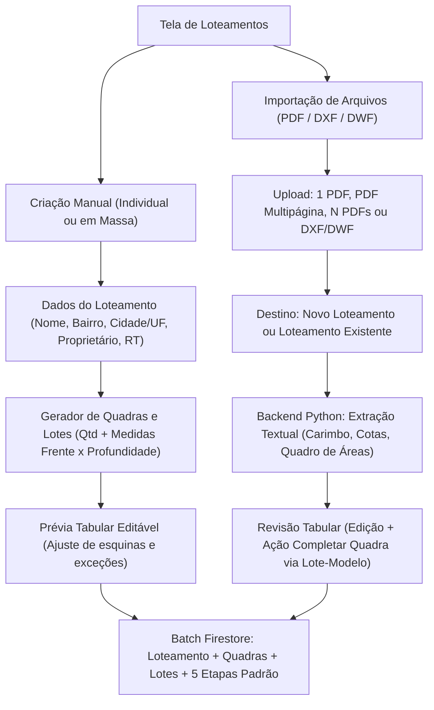
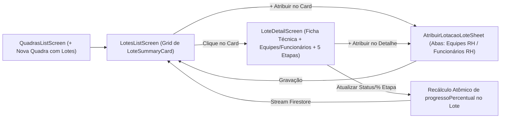

# Diagramas de Arquitetura e Fluxos (Sem Geometria)

## 1. Fluxos de Criação e Importação de Loteamentos



## 2. Navegação do Card do Lote, Detalhes 360º e Atribuição



## 3. Anatomia do Card do Lote (`LoteSummaryCard`) e Detalhes (`LoteDetailScreen`)

```text
+------------------------------------------------------------------+
| Lote 31                                    [Em andamento • 60%]  |
| Rua Sandoval Wanderley, s/n                                      |
+------------------------------------------------------------------+
| Frente x Prof: 10,00m x 20,00m | Terreno: 200m2 | Constr: 49,96m2|
+------------------------------------------------------------------+
| Conclusão das Etapas (3/5)                                   60% |
| [==================............]                                 |
| [v Muro] [v 1a] [v 2a] [.. 3a] [o Branca]                        |
+------------------------------------------------------------------+
| Equipe Alvenaria A • Joao Silva (Pedreiro)         [+ Atribuir]  |
+------------------------------------------------------------------+
```

**Ao clicar no `LoteSummaryCard`, abre `LoteDetailScreen`:**
1. **Cabeçalho e Ações**: Nome do lote, endereço, barra de progresso geral (`%`), botão **Editar Lote**.
2. **Ficha Técnica**:
   - **Medidas Principais**: Frente, Profundidade, Área do Terreno, Área Construída.
   - **Índices Urbanísticos e Recuos (exibidos quando preenchidos)**: Taxa de Ocupação, Coeficiente de Aproveitamento, Área/Taxa Permeável, Área Impermeável, Recuos (Frontal, Fundo, Laterais), Proprietário e Responsável Técnico.
3. **Equipes e Funcionários Vinculados**: Lista de alocações ativas no lote (com opção de remover em 1 toque e botão `+ Atribuir Equipe ou Funcionário`).
4. **Checklist das 5 Etapas (`Muro`, `Cinza/1ª`, `Cinza/2ª`, `Cinza/3ª`, `Branca/Acabamento`)**: Alteração rápida de status (`Pendente`, `Em andamento`, `Concluída`) e vínculo de responsável/equipe por etapa.
